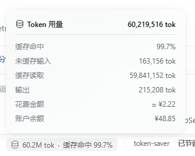
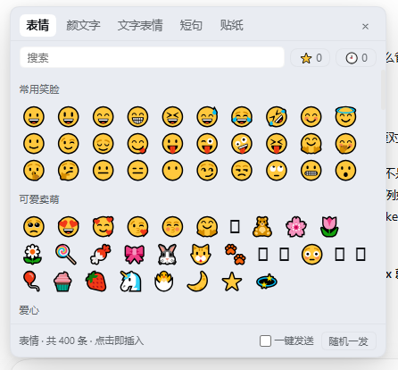

# DeepSeek Harness 插件集

自制的 **DeepSeek Harness（DSH）** 插件集合。每个插件是一个可独立安装的文件夹，带 README、`package.json`、`cordis.patch.yml`。


> ⚠️ 安装前请先读 [DISCLAIMER.md](./DISCLAIMER.md)（风险告知 / 免责声明）。插件会修改 DSH profile 配置，**请先备份**。
> 安全策略见 [SECURITY.md](./SECURITY.md)，数据处理见 [PRIVACY.md](./PRIVACY.md)。

## 插件

| 插件 | 说明 | 版本 | 文档 |
| --- | --- | --- | --- |
| [快速显示花费](./快速显示花费/) `dsh-plugin-inline-cost` | 官方「Token 用量」卡片打开时，末尾多两行：本会话「花费金额」+ 账号「账户余额」；会话金额取 `dsh-token-mb` 官方记录，单轮卡片按本轮数字估算 | **0.9.4** | [README](./快速显示花费/README.md) · [设计](./快速显示花费/docs/DESIGN.md) · [排错](./快速显示花费/docs/TROUBLESHOOTING.md) · [变更](./快速显示花费/CHANGELOG.md) |
| [更多表情和颜文字](./更多表情和颜文字/) `dsh-plugin-more-emoji` | 输入框旁的 Emoji / 颜文字 / 文字表情 / 短句 / 图片贴纸面板（44 分类 / 911 条 / 36 贴纸）；收藏、最近使用、一键发送；配置中心；附 `emoji_pack` 工具 | **0.7.3** | [README](./更多表情和颜文字/README.md) · [设计](./更多表情和颜文字/docs/DESIGN.md) · [排错](./更多表情和颜文字/docs/TROUBLESHOOTING.md) · [智能体](./更多表情和颜文字/docs/AGENT.md) · [变更](./更多表情和颜文字/CHANGELOG.md) |

| 花费金额 | 表情面板 |
| --- | --- |
|  |  |

两个插件都遵循同一条铁律：**不接管任何官方槽位、不替换官方组件**，只做「新 id 注册」或「纯 DOM 观察追加」；
任何异常都静默跳过，移除插件零残留。

## 快速开始

```text
1. 备份 profile → 2. 中文目录建 junction → 3. plugin_manager install_bundle → 4. 重启 DSH
```

细节见下一节「安装」。装完怎么用：花费插件点开用量卡片看最后两行；表情插件点输入框左侧 😊。

## 安装

通用步骤（以 Windows 为例）：

**1. 备份 profile**

```bat
set P=%USERPROFILE%\.dsh\profiles\desktop
copy "%P%\package.json" "%P%\package.json.bak"
copy "%P%\cordis.patch.yml" "%P%\cordis.patch.yml.bak"
```

**2. 中文目录先映射成 ASCII 路径（必须）**

pnpm 写 `package.json` 时会把中文路径写成 GBK 乱码，轻则清单损坏、重则 DSH 打不开。

```bat
mklink /J L:\work\plugins\more-emoji  "L:\work\deepseek-harness-plugins\更多表情和颜文字"
mklink /J L:\work\plugins\inline-cost "L:\work\deepseek-harness-plugins\快速显示花费"
```

**3. 在 DSH 里安装**

```text
plugin_manager install_bundle   target = L:\work\plugins\more-emoji
plugin_manager install_bundle   target = L:\work\plugins\inline-cost
```

**4. 校验 profile 没坏**

```bat
python -c "import json,os;p=os.path.expanduser('~/.dsh/profiles/desktop/package.json');d=json.load(open(p,encoding='utf-8'));print('OK',len(d['dsh']['profile']['bundles']),'bundles')"
```

**5. 生效**：**重启一次 DSH**（客户端 bundle 在 Host 启动时构建）。只刷新页面不一定能拿到新 bundle。

> 不想 clone？每个版本在 [Releases](https://github.com/zaowanshangxian/deepseek-harness-plugins/releases) 都有 `.tgz`，
> 下载后 `dsh plugin --profile desktop add ./xxx.tgz` 即可（它会自动写进 `dsh.profile.bundles`），然后重启 DSH。

装坏了打不开？双击桌面 **`DSH一键恢复.cmd`**（脚本 `L:\work\scripts\dsh-profile-recover.ps1`，`-DryRun` 可预演）。

## 卸载

```text
plugin_manager remove_bundle  dsh-plugin-more-emoji
plugin_manager remove_bundle  dsh-plugin-inline-cost
```

手动版：从 profile `package.json` 的 `dsh.profile.bundles` 删掉对应行 → `dsh plugin --profile desktop remove <包名>` →
`rmdir L:\work\plugins\<junction>`（只删链接，不删仓库）。残留数据见 [PRIVACY.md](./PRIVACY.md#卸载后留下什么)。

## 仓库结构

```text
deepseek-harness-plugins/
├── README.md / CONTRIBUTING.md / SECURITY.md / PRIVACY.md / FAQ.md / ROADMAP.md
├── CHANGELOG.md              # 版本汇总
├── CODE-REVIEW.md            # 代码审核记录（含历史问题）
├── DISCLAIMER.md             # 免责声明
├── docs/
│   ├── ARCHITECTURE.md       # 插件模型 / Host-Client / 槽位
│   ├── DEVELOPMENT.md        # 构建、校验、真实 GUI 验收
│   └── RELEASING.md          # 版本号、tag、发布检查
├── .github/                  # issue / PR 模板、CI
├── 快速显示花费/              # dsh-plugin-inline-cost
│   ├── README.md  CHANGELOG.md  package.json  cordis.patch.yml  icon.svg
│   ├── src/ lib/ tools/ locale/
│   └── docs/                 # USAGE / DESIGN / TROUBLESHOOTING + 截图
└── 更多表情和颜文字/          # dsh-plugin-more-emoji
    ├── README.md  CHANGELOG.md  package.json  cordis.patch.yml  icon.svg
    ├── src/ lib/ tools/ locale/ assets/stickers/
    └── docs/                 # USAGE / AGENT / DESIGN / TROUBLESHOOTING + 截图
```

## 兼容性

| 项 | 要求 |
| --- | --- |
| DSH | `>=0.2.1-rc.2 <0.3.0`（主力测试版本 `0.2.1-rc.3`） |
| Node | >= 20（插件本身不跑在 Node 里，构建脚本需要） |
| 可选依赖 | `dsh-token-mb`（花费插件用它取官方会话记录；没装则走估算） |
| 平台 | 桌面版 / `dsh web` 均可；贴纸的 paste 通道在个别版本可能失效（会静默跳过） |

## 智能体（模型）怎么用

- **更多表情和颜文字**：模型有 `emoji_pack` 工具（参数 `kind` / `category` / `query` / `count` / `random`），
  系统提示会自动教它怎么用、用多少。细节见 [AGENT.md](./更多表情和颜文字/docs/AGENT.md)。
- **快速显示花费**：纯 UI，**不提供工具**。模型不需要调用，也不要声称金额是官方账单（是官方记录或估算）。
- 两个插件都**不会自动上传**任何数据；错误记录只在浏览器本地，用户手动复制或提 issue 才会离开本机。

## 文档地图

| 文档 | 看它做什么 |
| --- | --- |
| [快速显示花费 使用说明](./快速显示花费/docs/USAGE.md) · [表情插件 使用说明](./更多表情和颜文字/docs/USAGE.md) | 装好后每天怎么用、每个数字/开关的意思 |
| [docs/ARCHITECTURE.md](./docs/ARCHITECTURE.md) | DSH 插件模型、Host/Client 两半、bundle 与槽位、两个插件的位置 |
| [docs/DEVELOPMENT.md](./docs/DEVELOPMENT.md) | 本地构建、校验、离线 harness、真实 GUI 的 CDP 验收 |
| [docs/RELEASING.md](./docs/RELEASING.md) | 版本号、tag、发布检查清单、网络不通时的推送兜底 |
| [CONTRIBUTING.md](./CONTRIBUTING.md) | 提 PR / 加内容 / 加插件的要求与流程 |
| [FAQ.md](./FAQ.md) | 反复被问的问题（装不上、不生效、打不开…） |
| [SECURITY.md](./SECURITY.md) | 安全模型、权限边界、怎么报告漏洞 |
| [PRIVACY.md](./PRIVACY.md) | 读什么、存哪里、去哪了 |
| [CODE-REVIEW.md](./CODE-REVIEW.md) | 代码审核记录（含历史问题清单与剩余风险） |
| [DISCLAIMER.md](./DISCLAIMER.md) | 免责声明（**安装前必读**） |
| [ROADMAP.md](./ROADMAP.md) | 想做的、不打算做的 |
| [ERROR-REPORTS/](./ERROR-REPORTS/) | 按版本记录的问题复盘 |

## 版本变更

- 根汇总：[CHANGELOG.md](./CHANGELOG.md)
- 花费插件：[快速显示花费/CHANGELOG.md](./快速显示花费/CHANGELOG.md)
- 表情插件：[更多表情和颜文字/CHANGELOG.md](./更多表情和颜文字/CHANGELOG.md)

## 参与

欢迎提 issue / PR：先读 [CONTRIBUTING.md](./CONTRIBUTING.md)；改代码请保持「零接管 + 保险丝 + 可卸载」三条不破。
新内容（表情/颜文字/短句）改 `更多表情和颜文字/src/packs.mjs` 一个文件即可。

## 许可

MIT（各插件文件夹内 `LICENSE`）。使用即视为已阅读并同意 [DISCLAIMER.md](./DISCLAIMER.md)。
