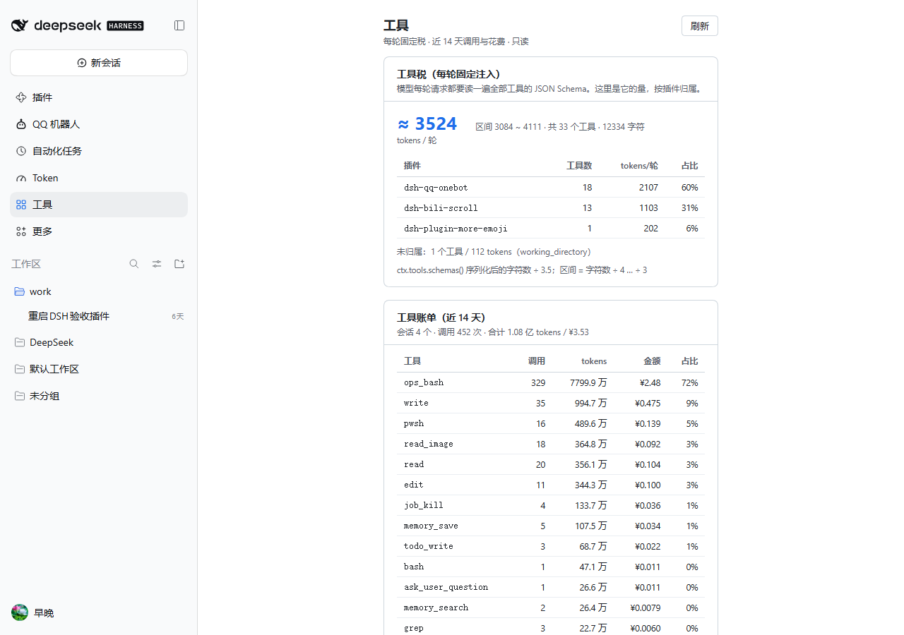

# 工具税 · dsh-plugin-tool-tax

**把「每轮对话固定注入的工具 JSON Schema」量出来**：总量多少 token、哪个插件占大头、哪几个工具最贵。

装完侧栏多一个「**工具**」入口（和 Token 并排），点进去是一整页：

- **工具税**：每轮固定注入的工具 schema ≈ N tokens/轮 + 按插件归属表
- **工具账单**：近 14 天每个工具的 调用次数 / 分摊 tokens / 分摊金额 / 占比



> 它只回答一个问题：**你不说话的时候，DSH 每轮已经替你付了多少 token。**
> 它不改配置、不删插件、不接管任何官方槽位。

---

## 一、它量什么，怎么量

| 数字 | 含义 | 方法 | 可信度 |
| --- | --- | --- | --- |
| 工具税总量 | 每轮把全部工具 schema 送进提示词的字符数 / 估算 token | `ctx.tools.schemas()` 拿到模型实际可见的工具定义，按 `{type,function:{name,description,parameters}}` 序列化后数长度，÷ 3.5 | 实测字符数 + **估算 token**（区间 = ÷4 … ÷3） |
| 按插件归属 | 每个插件贡献了几个工具、多少 token | 在 profile 的 `node_modules` 里找该工具名的字符串字面量；**只有一个包命中才算归属**，多命中/零命中记「未归属」 | 推断（声明形状匹配），不是运行时观测 |
| 最贵的工具 | Top 12 单工具开销 | 同上，按单条 schema 长度排序 | 实测字符数 |

**为什么 ÷3.5**：schema 是「英文键名 + 中文描述」的混合文本，实测中英混排大约 3–3.5 字符/token。面板同时给出 `÷4 … ÷3` 的区间，不把估算说成精确值；真值以每次调用返回的 `prompt_tokens` 为准。

**为什么不算系统提示词**：人格注入、记忆注入、技能索引走的是另一条通道，DSH 没有把它们作为工具 schema 暴露给插件。**本插件只量它能量准的那一段，不瞎估另一段。**

## 一·五、工具账单

面板第二块「**工具账单（近 14 天）**」：列出每个工具近 14 天的

| 列 | 含义 |
| --- | --- |
| 调用 | `tool/call` 次数（精确） |
| tokens | 该工具所在轮次（turn/step）的用量，按该轮工具数平摊 |
| 金额 | 同上，按 DeepSeek 峰谷价折算（与 `dsh-token-mb` 同一张价格表） |
| 占比 | 该工具 tokens / 全部工具 tokens |

**口径说明（重要）**：工具本身没有独立计费，一次 LLM 请求可能带多个工具调用。这里的做法是
**把该轮请求的用量平均分给它当轮的每个工具**——这是「归因」，不是账单。
它回答的是「哪个工具最贵」，不能拿单个工具的数字去对账。

**与 `dsh-token-mb` 的对账**（沙箱 4 个会话，14 天）：

| 指标 | token-mb | 工具账单 | 差异原因 |
| --- | --- | --- | --- |
| 调用数 | 423（LLM 请求次数） | 452（工具调用次数） | 维度不同：一轮请求可调多个工具 |
| 金额 | ¥3.6418 | ¥3.53 | 差约 3%：未匹配到 usage 的轮次不计价、四舍五入 |

**隐私**：会话日志是逐行 JSON，本插件只读 `type`、`data.name`、`data.turn/step`、`data.usage` 四类字段，
**不读、不存、不上传对话内容**。


## 二、为什么这件事值得量

一次 33 个工具的会话（沙箱实测）：

```
工具数 33 · 工具税 3524 tokens/轮 · 区间 3084 ~ 4111
  dsh-qq-onebot        18 个工具   2107 tok
  dsh-bili-scroll      13 个工具   1103 tok
  dsh-plugin-more-emoji 1 个工具    202 tok
  未归属（内置）        1 个工具    112 tok
```

关键不是「谁是第一名」，而是：**这些工具里有很多 14 天都没被调用过，但它们每轮都在付费**。
（配套的「插件管家」量的是启动开销，本插件量的是每轮固定税——两个数不能相加，见 [DESIGN](./docs/DESIGN.md)。）

## 三、安装

```bash
# 1) 从 Release 下 tgz
curl -L -o tool-tax.tgz https://github.com/zaowanshangxian/deepseek-harness-plugins/releases/download/tool-tax-v0.1.0/dsh-plugin-tool-tax-0.1.0.tgz

# 2) 装进 profile（会自动写 dsh.profile.bundles）
dsh plugin --profile desktop add ./tool-tax.tgz

# 3) 重启 DSH
```

本地开发（junction + link 安装）：见根目录 [docs/DEVELOPMENT.md](../../docs/DEVELOPMENT.md)。

## 四、边界（当前事实，不是待办）

- **只统计工具 schema**。系统提示词、人格/记忆注入、技能索引不在这个通道，本插件不估算。
- **token 是估算**：字符 ÷ 3.5，区间 ÷4…÷3。没有内置 DeepSeek 分词器，也不冒充精确。
- **归属靠源码字面量匹配**：`name: 'xxx'` 或被引号包住的工具名出现在某个包的文件里，且**只有一个包命中**才算它的。工具名由变量拼出来、或两个包都提到，就记「未归属」。
- **只扫 profile 层**：`agentPresets` 那一层（每会话工具插件）不在 `ctx.tools.schemas()` 里，扫不到。
- **只读**：不写文件、不发网络、不改 profile；卸载后零残留。
- 首次打开卡片会有一次亚秒级扫描（最多 400 个文件），之后 60 秒缓存；点卡片上的数字可强制刷新（`{force:true}` 走 API）。

## 五、隐私与安全

- 读取范围：`<profile>/package.json`、`<profile>/cordis.patch.yml`、`<profile>/node_modules/<已装插件>/**/*.{js,mjs,cjs}`（只读，跳过 `node_modules`、`.git`、`*.map`、`client*`）。
- **不上传**：所有计算在本机 Host 进程内完成，没有任何外部请求。
- 路由：只有 `POST /api/tool-tax/report`，body 上限 64 KB，非 POST 返回 405，坏 JSON 返回 400，异常不抛。
- 客户端：只在官方 `div[role="dialog"]` 卡片里追一个 `<dt>/<dd>`，任何异常静默跳过；不注入脚本、不改官方组件。

## 六、和「插件管家」怎么分工

| | 插件管家（dsh-plugin-curator） | 工具税（本插件） |
| --- | --- | --- |
| 量什么 | 启动耗时（整机 / 单插件冷加载 / UI 资源）、14 天调用次数 | 每轮固定注入的工具 schema |
| 数据来源 | Loader 状态 + 子进程 import + 浏览器 Resource Timing + 会话日志 `tool/call` | `ctx.tools.schemas()` + 源码字面量归属 |
| 结论 | 「这个插件该不该停用」 | 「这一轮还没说话就花了多少」 |
| 会不会改 profile | 会（停用/找回，带备份） | **不会，纯只读** |
| 两者相加？ | **不能**：一个是启动毫秒，一个是每轮 token | |

最实用的组合：**先用工具税找出「每轮最贵的那几个工具」，再决定停用哪个插件**；插件管家的 A/B 启动历史负责确认停用后的启动变化。

## 七、许可

MIT。仓库：[zaowanshangxian/deepseek-harness-plugins](https://github.com/zaowanshangxian/deepseek-harness-plugins)
