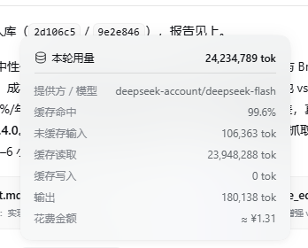
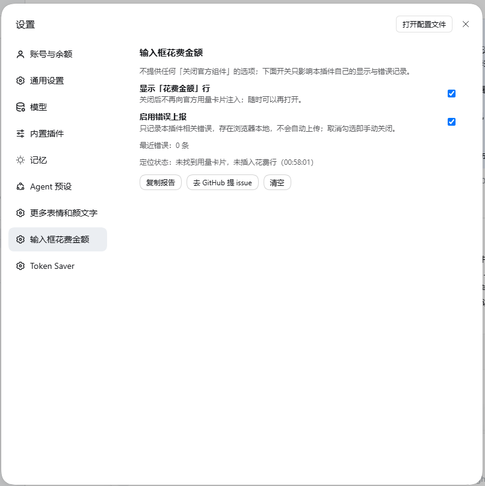

# 快速显示花费（dsh-plugin-inline-cost）

**只给官方「Token 用量」卡片加一行**：官方组件原封不动，点开用量卡片时，卡片末尾多出一行「花费金额」。

当前版本 **0.9.4** · MIT · 兼容 DSH `>=0.2.1-rc.2 <0.3.0`


```
Token 用量        8,634,397 tok
缓存命中          99%
未缓存输入        77,841 tok
缓存读取          8,494,080 tok
输出              62,476 tok
花费金额          ≈ ¥0.50        ← 插件加的第 1 行（本会话）
账户余额          ¥49.57         ← 插件加的第 2 行（账号剩余，仅会话卡片）
```

## 它做什么 / 不做什么

| 做 | 不做 |
| --- | --- |
| 官方卡片打开时，在 `<dl>` 末尾追加一行「花费金额」 | 不注册、不替换、不复用任何官方槽位 |
| 会话卡片用本机 `dsh-token-mb` 的官方记录（按会话） | 不读取、不上传你的会话内容 |
| 单轮卡片按这一轮的数字估算 | 不冒充官方账单，不用于对账/报销 |
| 卡片关闭即移除，异常一律静默跳过 | 不抓取输入框、不拦截请求 |

## 两种卡片

| 卡片 | 从哪里打开 | 金额含义 | 数据来源 |
| --- | --- | --- | --- |
| **会话卡片** | 输入框下方 `8.6M tok · 缓存命中 99%` | 本会话累计 + 账户余额 | `dsh-token-mb` 的 `/token-mb/summary`（按会话标题匹配）与 `/token-mb/balance`（账户余额） |
| **单轮卡片** | 消息底部 `用量 24.2M tok` | 这一轮 + 账户余额 | 卡片上本轮数字 × 当前时段峰谷价，标题写明「本轮估算」；余额同会话卡片 |

单轮卡片长这样（`提供方 / 模型` 那行是官方原有的，插件只加最后一行）：



## 安装

> ⚠️ 先读仓库根目录 [DISCLAIMER.md](../DISCLAIMER.md)，安装前备份 profile。

**1. 备份 profile**

```bat
set P=%USERPROFILE%\.dsh\profiles\desktop
copy "%P%\package.json" "%P%\package.json.bak"
copy "%P%\cordis.patch.yml" "%P%\cordis.patch.yml.bak"
```

**2. 把中文目录映射成 ASCII 路径（必须）**

pnpm 写 `package.json` 时会把中文路径转成 GBK 乱码，轻则清单损坏、重则 DSH 打不开。

```bat
mklink /J L:\work\plugins\inline-cost "L:\work\deepseek-harness-plugins\快速显示花费"
```

**3. 在 DSH 里安装**（让 Agent 调 `plugin_manager`）

```text
plugin_manager install_bundle
target = L:\work\plugins\inline-cost
```

命令行等价物：`dsh plugin --profile desktop add L:\work\plugins\inline-cost`，再把 `dsh-plugin-inline-cost`
加进 profile `package.json` 的 `dsh.profile.bundles`（`install_bundle` 会自动做这两步）。

**4. 校验 profile 没被写坏**

```bat
python -c "import json,os;p=os.path.expanduser('~/.dsh/profiles/desktop/package.json');d=json.load(open(p,encoding='utf-8'));print('OK',len(d['dsh']['profile']['bundles']),'bundles')"
```

**5. 生效**：**重启一次 DSH**（客户端 bundle 在 Host 启动时构建）。刷新页面不一定拿得到新 bundle。

## 卸载

```text
plugin_manager remove_bundle  dsh-plugin-inline-cost
```

或手动三步：

1. 从 profile `package.json` 的 `dsh.profile.bundles` 里删掉 `"dsh-plugin-inline-cost"` 这一行；
2. `dsh plugin --profile desktop remove dsh-plugin-inline-cost`；
3. 删 junction：`rmdir L:\work\plugins\inline-cost`（只删链接，不会删仓库）。

插件不写任何 DSH 配置文件；卸载后浏览器里可能残留两条 localStorage（`dsh-inline-cost:disabled`、
`dsh-errors:dsh-plugin-inline-cost`），可无视，也可在 DevTools 里删掉。

## 配置（设置 → 快速显示花费）



| 选项 | 作用 |
| --- | --- |
| 显示「花费金额」行 | 关掉就不再注入；随时可以再打开 |
| 启用错误上报 | 只记录本插件相关错误（浏览器 localStorage，最多 20 条，去重），**不会自动上传**；取消勾选即关闭 |
| 定位状态 | 自检：是否找到用量卡片（会话卡片/单轮卡片）、是否已插入花费行、检测时间 |
| 复制报告 / 去 GitHub 提 issue / 清空 | 手动带走错误记录 |

> 「定位状态」是排错第一现场：显示「未找到用量卡片」说明当时卡片没开，或官方改版了
> —— 见 [docs/TROUBLESHOOTING.md](docs/TROUBLESHOOTING.md)。

## 数据来源与准确性

- **会话卡片优先**：本机 `dsh-token-mb`（社区插件，作者 oli20）的只读接口 `/token-mb/summary`，
  返回 `{ ok: true, data: { sessions } }`。它按会话逐次累加、每次调用按当时峰谷与实际模型计价，和官方账单对得上。
  插件用**当前会话标题**（官方面包屑）匹配记录，匹配不到才退回「最近写入的非子代理会话」，此时可能取错会话
  —— 悬停「花费金额」能看到用的到底是哪一个会话。
- **单轮卡片**：只用这一轮卡片上的 `未缓存输入 / 缓存读取 / 缓存写入 / 输出`，乘以当前时段价格，属于估算。
- **账户余额**：会话卡片第二行「账户余额」，数据来自 `dsh-token-mb` 的 `/token-mb/balance`
  （开源 MIT：[olimc2016/dsh-token-meter-panel](https://github.com/olimc2016/dsh-token-meter-panel)）。
  字段按上游源码取：`data.balance_infos[].total_balance`（优先 CNY）、`data.total_costs[].amount`（累计消费）。
  在 token-mb 设置里关掉 `showBalance` 时它会返回 `supported:false`，本插件就不显示这一行。
- **兜底**：token-mb 没装或接口异常 → 会话卡片也退回按卡片数字估算，余额行不显示。
- 界面上的 `≈` 表示这是记录值或估算值，不是官方账单金额。

## 计价口径

DeepSeek 官方 CNY / 百万 token 峰谷价（与 `dsh-token-mb` 同口径，2026-09-19 抓取）：

| 模型 | 缓存命中 | 未缓存输入 | 输出 |
| --- | --- | --- | --- |
| deepseek-flash / v4-flash | 0.02（低谷）/ 0.04（高峰） | 1 / 2 | 4 / 8 |
| deepseek-v4-pro | 0.15 / 0.3 | 4.5 / 9 | 13.5 / 27 |

- 高峰：北京时间 **周一至周五 9:00–12:00、14:00–18:00**，其余为低谷价
- 单轮卡片与兜底路径统一按**当前时段**估，允许与官方账单有几分差异
- 会话卡片直接用 token-mb 的记录，不参与这里的估算

## 工作原理（只读观察，零接管）

1. 监听整个文档（含 shadow DOM）里 `role="dialog"` 且 `aria-label` 为 `Token 用量` / `本轮用量` 的卡片
2. 取卡片里承载明细的 `<dl>`：官方 CSS 把它定义成 **dt/dd 两列网格**
3. 往 `<dl>` 末尾追加 `<dt>花费金额</dt><dd>≈ ¥x</dd>`，列宽、右对齐、字号颜色全部继承官方样式
4. 卡片关闭 → 官方 portal 卸载 → 追加的两个节点跟着消失；另有 `MutationObserver` + 1.5s 兜底，重渲染也能补回

细节、代码地图与踩过的坑见 [docs/DESIGN.md](docs/DESIGN.md)。

## 兼容性

- DSH `>=0.2.1-rc.2 <0.3.0`（在 `0.2.1-rc.3` 实测）
- 依赖的官方 DOM 契约：卡片 `role="dialog"` + `aria-label`（`Token 用量` / `本轮用量`）、明细 `<dl>`、
  单轮面板的 `data-turn-usage-details` 属性
- 依赖的可选插件：`dsh-token-mb`（没装就走估算）
- 唯一外部请求是同源的 `/token-mb/summary`，不访问互联网

## 排错

症状 → 原因 → 处理见 [docs/TROUBLESHOOTING.md](docs/TROUBLESHOOTING.md)：

- 卡片里没有「花费金额」
- 配置页里没有「定位状态」
- 金额明显比官方账单低/高
- 装完 DSH 打不开

## 隐私

- 只在浏览器本地记录最近 20 条错误；不写文件、不发网络
- 不读取会话内容、不读取输入框；只读卡片上本来就显示给你的数字
- 详见仓库根目录 [PRIVACY.md](../PRIVACY.md)

## 开发

```bash
node tools/build.mjs     # src/client.js → lib/client.js（构建就是把源码拷过去）
node --check lib/client.js
```

改完 `lib/` 要**重启一次 DSH**；只刷新页面有时也能拿到新 bundle，但不可依赖（实测：改名前刷新后设置页仍是旧名字）。验证方式见仓库
[docs/DEVELOPMENT.md](../docs/DEVELOPMENT.md)（离线 harness + 真实 GUI 的 CDP 验收）。

## 智能体怎么用

本插件纯 UI，**不提供工具**。模型不需要调用它，也不要声称金额是官方账单（是官方会话记录或估算）。

## 风险与免责（必读）

- 按「现状」提供；会话卡片优先取 `dsh-token-mb` 记录，单轮卡片与兜底路径按卡片数字估算，
  **可能与官方账单有差异，不能作为对账/报销依据**
- 会话匹配是启发式（先按标题，退化为最近写入的非子代理会话），多窗口同时活跃且标题重名时可能取错；悬停可查明细
- 官方改版导致卡片找不到时，插件静默不显示，不影响官方功能
- 安装路径必须 ASCII junction
- 详细条款见 [DISCLAIMER.md](../DISCLAIMER.md)；使用即视为同意

## 许可

MIT
