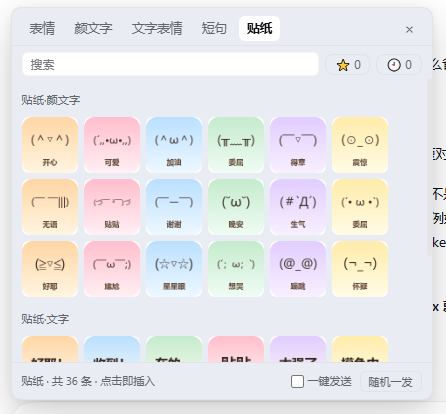

# 更多表情和颜文字（dsh-plugin-more-emoji）

给 DeepSeek Harness 加一个**表情面板**：输入框工具栏点 😊 就能打开，把 Emoji、颜文字、文字表情、聊天短句插到光标处，还能发**图片贴纸**；同时提供 `emoji_pack` 工具 + 一段系统提示，让模型也能自然取用更多表情和文字。

- **44 个分类 / 911 条文本**（表情 400 · 颜文字 280 · 文字表情 81 · 短句 150）+ **36 张图片贴纸**
- 点一下插入光标处；可开「一键发送」改成点一下直接发出
- ⭐ 收藏、🕘 最近使用，跨页签共享
- 面板浮在输入框上方，不遮输入内容；主题跟随 DSH 深浅色
- 无第三方运行时依赖、无网络请求


## 功能

**表情面板（给人用）**

- 5 个页签：表情 / 颜文字 / 文字表情 / 短句 / 贴纸
- 分类标题吸顶；搜索框实时过滤
- **文本类**：点条目 → 通过 composer 的官方 `inputActions`（`captureInsertion` + `insertText`）插到光标处，兼容 contenteditable 编辑器
- **图片贴纸**：点贴纸 → 把 PNG 合成 `paste` 事件交给 DSH 上传成附件，停在输入框等你发送（开「一键发送」则直接发出）


- **一键发送**：设置 → 通用 → 「更多表情和颜文字」勾选，或面板底部迷你开关；开启后点条目 = 发送
- **收藏**：鼠标悬停条目点 ☆；⭐ 页签统一查看/取消
- **最近使用**：自动记录最近 40 条，🕘 页签查看
- `Esc` / 点面板外部关闭

**emoji_pack 工具（给模型用）**

模型可以主动调用它取分类目录或具体条目，把更多表情/颜文字/短句自然地写进回复。

| 参数 | 类型 | 说明 |
| --- | --- | --- |
| `kind` | `emoji` \| `kaomoji` \| `art` \| `phrase` | 大类 |
| `category` | string | 分类 id 或名字片段，如 `emoji-love`、`猫`、`夸夸` |
| `query` | string | 关键词过滤（匹配分类 id / 名字） |
| `count` | integer 1-40 | 期望条数，缺省 12；只选一个分类时返回该分类全部条目 |
| `random` | boolean | 是否随机取样，缺省 false |

示例：

```text
emoji_pack()                                  → 返回完整分类目录
emoji_pack({ kind: "kaomoji", category: "猫" }) → 颜文字·猫猫 20 条
emoji_pack({ kind: "phrase", query: "夸" })     → 夸夸类短句
emoji_pack({ kind: "art", random: true })       → 随机一组文字表情
```

**给智能体的说明（自动注入系统提示）**

安装后 Host 半侧会注册一段 `systemPrompt.section`（order 2950），告诉模型：有这个工具、参数怎么用、一条回复 1-3 个为宜、正式内容别加、用户说别用就不要用。完整文本见 [docs/AGENT.md](docs/AGENT.md)。

## 配置中心（设置 → 更多表情和颜文字）

所有配置都在这一个页面里，**同一份配置同时作用于客户端面板和 DeepSeek 的 `emoji_pack` 工具**（Host 与客户端共读 `DSH_HOME/more-emoji/settings.json`）。

| 配置项 | 作用 |
| --- | --- |
| 隐藏客户端面板 | 勾选后输入框旁的 😊 按钮与浮层面板都不显示；本配置页仍可用，随时关回来 |
| 优先发送常用表情 | 开启后，DeepSeek 需要发表情时会**优先用「常用」里的词/表情**（提高权重），系统提示里会带上这份清单 |
| 允许发送的表情分类 | 44 个分类逐个勾选；不选 = 全部允许。面板只显示允许的分类，`emoji_pack` 也只返回允许的分类 |
| 常用词 / 常用表情 | 客户端随时添加/删除（例如 `晚安喵～`、`(๑•̀ㅂ•́)و✧`、`抱抱`）；面板会多出「常用」页签，模型侧把它们置顶 |
| 收藏也参与优先 | ⭐ 收藏的表情会同步给 Host，`emoji_pack` 与系统提示同样按收藏加权（可关） |

- 立即生效：Host 侧读取配置文件后，`emoji_pack` 输出与系统提示实时改变；客户端面板在保存后即时更新
- 页面入口：**设置 → 更多表情和颜文字**（同时也在「插件」页的本插件配置里出现）
- 配置存储：`%USERPROFILE%\.dsh\more-emoji\settings.json`（按机器保存，可手动备份）
- 安全边界：配置 API 只监听本机 DSH Web 服务，写请求做同源校验（跨域返回 403）、body 上限 64KB；配置文件只保存在本机

## 安装

插件通过 DSH 的 bundle 机制安装（当前未上架 npm，用本地文件夹安装）。（当前未上架 npm，用本地文件夹安装）。

```bash
git clone https://github.com/zaowanshangxian/deepseek-harness-plugins.git
cd deepseek-harness-plugins
```

在 DeepSeek Harness 里让 Agent 执行：

```text
plugin_manager install_bundle，
target = <仓库路径>/更多表情和颜文字（Windows 例如 L:\work\deepseek-harness-plugins\更多表情和颜文字）
```

安装后**重启一次 DSH（或重开窗口）**让客户端 bundle 生效，输入框工具栏左侧出现 😊。

## 使用

1. 点输入框左侧的 😊 打开面板；
2. 切页签 / 搜索，点条目即插入（或按设置直接发送）；
3. 悬停条目点 ☆ 收藏；⭐ / 🕘 查看收藏与最近；
4. 贴纸页点图片 → 作为图片附件贴到输入框，回车发送；
5. `Esc` 或点外部收起。

## 内容库

| 大类 | 分类数 | 条数 | 例子 |
| --- | --- | --- | --- |
| 表情 emoji | 16 | 400 | 常用笑脸、可爱卖萌、爱心、美食、动物、手势、天气自然、困倦睡觉… |
| 颜文字 kaomoji | 14 | 280 | 开心、可爱、撒娇卖萌、汗与无语、生气炸毛、猫猫、害羞、长条颜文字… |
| 文字表情 art | 4 | 81 | 组合表情、框框字（`╭━━━╮` 好耶 `╰━━━╯`）、分割装饰、符号表情 |
| 短句 phrase | 10 | 150 | 夸夸、撒娇、日常回复、早晚安、摸鱼吐槽、鼓励、节庆祝福、网络梗… |
| 图片贴纸 sticker | 2 组 | 36 | 颜文字贴纸 18 张 + 文字贴纸 18 张（128×128 PNG，内联在客户端 bundle） |

改文本：编辑 `src/packs.mjs`；改贴纸：编辑 `tools/make-stickers.py` 后重新生成。两者都是**单一数据源**，再跑构建。

## 目录结构

```text
更多表情和颜文字/
├── package.json            # bundle 声明（dsh.bundle.patch / dsh.client）
├── cordis.patch.yml        # 插入一行 more-emoji
├── icon.svg                # 插件图标
├── locale/{zh,en}.json     # 插件页标题与描述
├── assets/stickers/        # 36 张 PNG + manifest.json（由脚本生成）
├── lib/                    # 构建产物（Host 工具/提示 + Client 面板 + 内联数据）
├── src/
│   ├── packs.mjs           # ★ 文本内容库单一数据源
│   ├── host.mjs            # Host：emoji_pack 工具 + 系统提示段
│   └── client.template.js  # Client：面板/贴纸/收藏/最近/设置行
├── tools/
│   ├── build.mjs           # 生成 lib/（内联文本 + base64 贴纸）
│   ├── check.mjs           # 校验文本库（重复/空项/坏字符）
│   └── make-stickers.py    # 生成贴纸 PNG + manifest
└── docs/
    ├── panel.png           # 面板截图
    └── AGENT.md            # 给智能体看的说明（同时注入系统提示）
```

## 开发

```bash
python tools/make-stickers.py   # 重新生成贴纸（需要 Pillow）
node tools/build.mjs            # 生成 lib/
node tools/check.mjs            # 校验文本内容库
```

改完 `lib/` 后：`remove_bundle` + `install_bundle`，再刷新页面（客户端 bundle 需重新加载；某些 DSH 版本要重启一次）。

## 兼容性

- DeepSeek Harness `>=0.2.1-rc.2 <0.3.0`（Node >= 20）
- 使用的扩展点：`conversation.input.left`（按钮）、`conversation.input.overlay`（面板）、`settings.general.item`（勾选项）、Host 的 `tools` 与 `systemPrompt` 服务
- 输入/发送走 composer 槽位注入的官方 `inputActions`（`captureInsertion` / `insertText` / `submit`），不做 DOM 模拟（DOM 仅作兜底）
- 不改内核、不写 profile 配置文件

## 已知边界

- 贴纸是 36 张内置 PNG；暂不支持导入自定义图片
- 「一键发送」依赖 DSH 的 `submit()`；若宿主版本没有该 API，会退回"插入 + 提示按回车"
- 收藏/最近/开关存浏览器 `localStorage`（按机器保存，不跨设备同步）

## 许可

MIT


## ⭐ 收藏与智能体权重

- 在面板里点 ☆ 收藏后：「收藏」页签会出现该条目，并**同步给 Host**
- Host 会把它写进系统提示，告诉智能体「这些是用户收藏的表情，需要发表情时**优先使用、权重更高**」
- 配置页「收藏也参与优先」开关可关闭这个加权（默认开启）
- 收藏只影响表情/颜文字的选择倾向，不会强制或保证一定发送

## 风险与免责（必读）

- 本插件按「现状」提供，不保证无缺陷；安装/卸载会修改 DSH profile 配置，**请先备份 profile**
- 安装路径必须用 ASCII junction（中文路径会被 pnpm 写坏 profile，导致 DSH 打不开）
- 客户端改动需**重启 DSH** 生效；贴纸依赖合成 paste，DSH 编辑器大改时可能静默失效
- 详细条款见仓库根目录 [DISCLAIMER.md](../DISCLAIMER.md)；使用即视为同意

## 错误上报与调试（在插件配置页里，可手动关闭）

- 位置：**设置 → 输入框花费金额 / 更多表情和颜文字**（也出现在插件页的配置里）
- 选项：**启用错误上报**（取消勾选即手动关闭）、最近错误列表、复制报告、去 GitHub 提 issue、清空
- 「显示花费金额」开关只控制本插件是否注入那一行；**不提供关闭任何官方组件的选项**
- 只在浏览器本地记录最近错误（最多 20 条，去重），**不会自动上传**

## 智能体怎么用

模型侧工具：`emoji_pack`（list / search / pick）；系统提示会自动注入使用约定。
「收藏 / 常用词优先」会提高模型选择这些内容的倾向（提示层引导，非硬性概率）。
完整说明见 [docs/AGENT.md](./docs/AGENT.md)。
